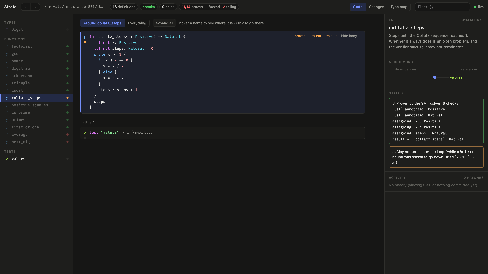

# Strata

An experimental programming language designed for working with agents: code that says what it means, checked and proven as it is written.

```rust
/// A decimal digit: an `Int` with a constraint, checked wherever one is made.
type Digit = Int where 0 <= it && it <= 9

/// n! is never 0.
fn factorial(n: Natural) -> Positive {
  if n == 0 { 1 } else { n * factorial(n - 1) }
}

/// Wrong: a digit plus one isn't always a digit.
fn next_digit(d: Digit) -> Digit {
  d + 1
}
```

```text
$ strata --file examples/math.strata verify
✓ factorial                proven (2 checks)
✗ next_digit               Refinement violation (found by the solver)
    input:   [9]
    result of `next_digit`: 10 does not satisfy `Digit` (where 0 <= it && it <= 9)
```

`factorial` is proven for every input: its result is always positive, and it always terminates. `next_digit` is refuted with the input that breaks it, before anything runs.

## What Strata is for

- **Constraints live in the types.** Refinement types (`Int where 1 <= it && it <= 99`), `requires` / `ensures` contracts, algebraic data types, unions and exhaustive matching.
- **Contracts are proven, not just tested.** An SMT solver (Z3 or cvc5) proves what it can; what it can't prove is fuzzed, and every result says which. Termination is shown too, or flagged.
- **You work on definitions, not files.** Definitions are syntax trees identified by content hash; text is a view at the level of detail you need, and every edit is checked against the whole codebase before it is committed.
- **Incomplete programs still check.** A typed hole (`?name`) has a goal type, a context and obligations: a precise task to hand to an agent.
- **Capabilities are values.** A database or a clock is a trait passed as a parameter, so a signature shows what code can touch, and a test passes a fake or `mock`.
- **Everything is JSON.** Every value serializes to JSON, and JSON inputs are parsed against the types, refinements included.

> Status: **an experimental draft**, a tree-walking interpreter in Rust, and the first steps of a native compiler through LLVM (`strata build`).

## Try it

```sh
cargo build --release
alias strata=$PWD/target/release/strata

# Code is stored as its syntax tree (binary .strata files): read it as text…
strata --file examples/orders.strata render

# …work directly on a file…
strata --file examples/orders.strata check
strata --file examples/orders.strata test
strata --file examples/orders.strata verify

# …or in a package, where every change is checked and logged
mkdir /tmp/shop && cd /tmp/shop
strata init
strata add path/to/examples/orders.strata
strata view --level 0              # map of everything
strata view slice:Order --level 1  # Order, what it uses, what uses it: interfaces only
strata holes                       # what's left to implement
strata ui                          # open http://127.0.0.1:7777: the live viewer
```

`strata ui` is the live viewer. Here it shows `examples/math.strata` after `strata verify`: every definition with its status, the selected function's code, and what the verifier said about it, here proven, but not shown to terminate (it is the Collatz sequence).



## Documentation

- [Learn Strata in Y minutes](docs/learn-strata.md): the whole language and the tools on one page, as one valid file. Give it to an agent before it writes Strata.
- [The language](docs/language.md): types, refinements, unions, traits, modules, mutation, errors, the standard library.
- [Verification](docs/verification.md): what `strata verify` proves, with examples and the verifier's output.
- [Tools](docs/tools.md): the command line, the viewer, storage, packages and git.
- [Internals](docs/internals.md): how the source is laid out.
- [The binary format](docs/binary-format.md): code stored as its syntax tree, a module file per module, each with a header.
- [Ideas, decisions and open questions](IDEAS.md): where Strata is going.
