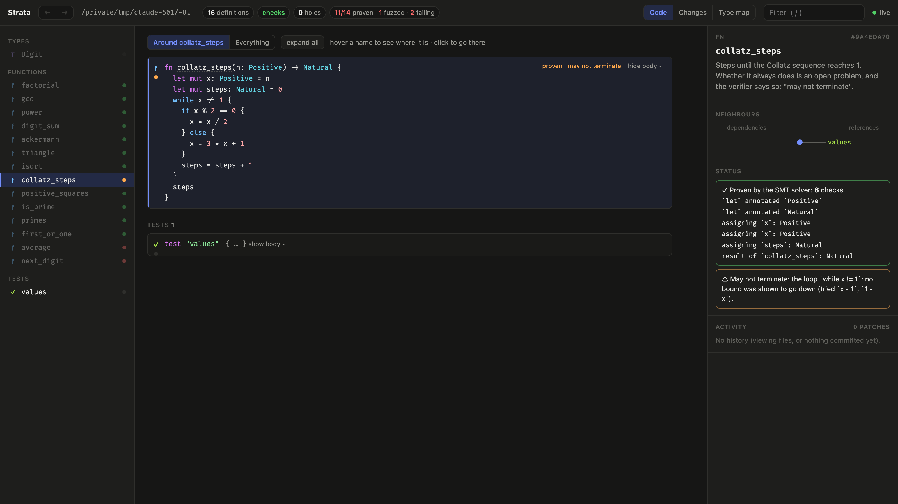

# Tools

The command line, the viewer, and how a codebase is stored and merged.

## What the tools tell you

```text
$ strata check                               # static errors are caught before running
error in status: non-exhaustive match on `Order`: `Cancelled` is not covered
error in sneaky: calling `load`: `String` does not implement `Db`
error in bad_qty: refinement violated at compile time in field `Line.qty`: 120 does not satisfy `Quantity` (where 1 <= it && it <= 99)

$ strata holes
?refund_policy  in refund
  goal:    Cents  (= Int + refinement)
  context: o: Order
  must:    ensures it >= 0

$ strata verify                              # prove every contract with Z3; fuzz what it can't prove
✓ line_total               proven (2 checks)
✓ total                    proven (3 checks)
✓ discount                 proven (2 checks)
✓ ship                     proven (5 checks)
○ refund                   incomplete: reached unfilled hole `?refund_policy` (via refund)

$ strata verify bump                         # fn bump(q: Quantity) -> Quantity { q + 1 }
✗ bump                     Refinement violation (found by the solver)
    input:   [99]
    result of `bump`: 100 does not satisfy `Quantity` (where 1 <= it && it <= 99) (stack: bump)

$ strata edit -m "steeper discount" < discount.strata
fn     discount                 changed  #fc40aad7… → #2e54e58d…  (implementation only — dependents unaffected)

$ strata edit < breaking_change.strata
error in test "totals": call to `total`, argument 1: expected `Int`, found `Line`
rejected: the codebase would not check; nothing was changed

$ strata rename total order_total
renamed total → order_total
updated 1 definition that refers to it: test "totals"

$ strata rename Shipped Sent              # a variant; trait methods work the same way
renamed Shipped → Sent
updated 3 definitions that refer to it: order_id, ship, test "shipping a pending order saves it as shipped"

$ strata rename Line.qty quantity         # a field: accesses, literals, updates, patterns
renamed Line.qty → Line.quantity
updated 3 definitions that refer to it: line_total, test "shipping a pending order saves it as shipped", test "totals"

$ strata rename A.tag label B.tag label   # several renames in one step (here, a field read from `A | B`)
renamed A.tag → A.label, B.tag → B.label
updated 1 definition that refers to them: tag_of

$ strata move charge billing              # to another module (file): references and imports follow
moved orders.charge from orders to billing (billing.strata)
updated 1 definition that refers to it: test "charges"
imports: orders: use billing.charge; main: use billing.charge

$ echo 'fn tax(amount: Int, rate: Int) -> Int { amount * rate / 100 }' | strata edit -m "tax takes a rate"
the edit breaks 2 uses elsewhere; they are now holes, in a pending change:
  ?pending_1  in total
      was: tax(amount)
      why: call to `tax`: expects 2 arguments, got 1
  ?pending_2  in double_tax
      was: tax(a)
      why: call to `tax`: expects 2 arguments, got 1
fill them with `strata edit`, then `strata done` (or `strata abort` to undo the whole change)

$ strata done                             # once the holes are filled: one log entry for it all
recorded "tax takes a rate" as one change: 3 definitions

$ strata edit total                       # nothing piped in: opens `total` in $VISUAL / $EDITOR;
                                          # what you save is the edit
$ strata edit shop                        # the module `shop` (or `shop.strata`, also a new module)
$ strata edit main.main                   # the definition `main` of the root module `main`
$ strata edit                             # the whole package, one file per module
$ strata edit shop < defs.strata          # piped: the definitions go into the module `shop`

$ strata run total '[[{"sku":"tea","qty":2,"unit_price":450},{"sku":"cup","qty":1,"unit_price":1200}]]' --trace
{"event":"call","fn":"total","args":[[{"sku":"tea","qty":2,"unit_price":450},{"sku":"cup","qty":1,"unit_price":1200}]],"depth":1}
{"event":"call","fn":"line_total","args":[{"sku":"tea","qty":2,"unit_price":450}],"depth":2}
{"event":"return","fn":"line_total","value":900,"depth":2}
{"event":"call","fn":"line_total","args":[{"sku":"cup","qty":1,"unit_price":1200}],"depth":2}
{"event":"return","fn":"line_total","value":1200,"depth":2}
{"event":"return","fn":"total","value":2100,"depth":1}
2100

$ strata run total '[[]]'                    # arguments are checked against the types
error: invalid input: lines: [] does not satisfy `NonEmpty` (where len(it) > 0)
```

## Compiling to native code

`strata build` compiles a program to an executable through LLVM: it writes LLVM IR as text, and `clang` compiles it with a small C runtime (`STRATA_CC` chooses another compiler). `--emit-llvm` prints the IR instead.

```text
$ strata build tests/data/build/numbers.strata -o numbers
built numbers
$ ./numbers
2432902008176640000
gcd = 6, 2^10 = 1024, A(2, 3) = 9
...
fault (Refinement): result of `next_digit`: 10 does not satisfy `Digit` (where 0 <= it && it <= 9)
```

A compiled program behaves as `strata run`: the same output, and contracts are checked at run time with the same fault messages (refinements of parameters, results, annotated bindings, declared variables and new values, `requires`, `ensures`, `assert`), exiting with 101. Only part of the language compiles so far:

- `Int` (64 bits for now: an overflow is a fault, where the interpreter switches to a big integer), `Float`, `Bool`, `String`, `()`, and refinements of them;
- records, variants (`Option`, `Result` and your own), tuples, `distinct` types, unions of variants; field access, `{ ..e, f: x }`, assigning a field (`x.a.b = e`), `is`, `==` on any of them, and printing them as the interpreter does;
- generic functions and types (each compiled once per set of type arguments), a type's own methods (`impl Item { ... }`), and traits: implementations chosen from the type where the call is compiled (default methods, supertraits, generic traits and implementations, static methods like `T.empty()`, a variant's own implementation chosen by its tag), with the trait's `requires` and `ensures` on every implementation;
- lists: literals, `+`, list patterns (`[x, ..rest]`), `for` over a list, `xs[i]` and slices (`xs[1..]`), and the list built-ins (`len`, `get`, `at`, `slice`, `push`, `take`, `drop`, `range`, `map`, `filter`, `fold`, `all`, `any`, `find`, `count`, `contains`, `reverse`, `sort`, `sort_by`, `zip`, `enumerate`, `sum`, `join`), most of them written in Strata (`src/llvm/prelude.strata`);
- dictionaries and sets: literals (`Dict { "a": 1 }`, `Set { 1, 2 }`, typed empty ones), `dict`, `set`, `insert`, `remove`, `get`, `contains`, `keys`, `values`, `items`, `map_values`, `to_list`, `union`, `intersection`, `difference`, `len`, `for` over them (a dictionary gives `(key, value)` pairs), `==`, printing (a dictionary with string keys as a JSON object), and the refinements of their elements, keys and values. Each is a list kept in the interpreter's order (a set's elements, a dictionary's pairs by key), so equal collections are equal lists; their built-ins are Strata over lists, given the order of the element type;
- strings: `+`, comparisons, `s[i]` and slices (`s[1..]`), and the string built-ins (`len`, `split`, `lines`, `trim`, `contains`, `starts_with`, `ends_with`, `index_of`, `replace`, `repeat`, `reverse`, `chars`, `get`, `at`, `slice`, `to_upper`, `to_lower`, `is_digit`, `is_alpha`, `is_space`, `ord`, `chr`, `parse_int`, `parse_float`, `to_json`), indexed by character as the interpreter does; case mappings and `is_alpha` use tables made from Rust's, which the interpreter uses;
- lambdas and closures, named functions as values (`filter(is_prime)`), functions returning functions;
- functions and recursion, bindings (`x := e`, with patterns, `let x: T = e`), `mut` variables and assignment (`=`, `+=`, …), `if`, `match` with every pattern, `while`, `loop`, `for`, `break`, `continue`, `return`, `assert`, `!`, `?`, `except`;
- f-strings with format specs (`{x:.2}`, `{n:>5}`, `{n:05}`, `{s:*^9}`), and `print`, `to_string`, `abs`, `min`, `max`, `float`, `floor`, `ceil`, `round`, `sqrt`;
- `mut` parameters and receivers (`restock(mut line.qty, 5)`, `mut console.print(s)`): the function changes the caller's variable in place, and the variable's declared type is checked after the call;
- capabilities: `main` can ask for `Console`, `Files` and `Environment` (std.io, std.fs, std.process), and gets the terminal, the disk and the process, as with `strata run` (the program's arguments too). A parameter whose type is a trait (`console: Console`) is compiled once per implementation passed to it, as the language defines it (`console: C` for some `C: Console`): the real console and a `Recorder` in a test each get their own. A trait used as the type of a field, a list element or a `let` (`{ console: Console }`, `List[Shape]`) holds any implementation: the value carries its implementation's table of methods, and calls go through it;
- options: `main` can ask for a record that derives `CommandLine` (std.cli); the compiled program reads it with the same `from_args`, so `--help` and the messages for bad arguments are `strata run`'s (exit code 0 after the help, 2 after an error). The usage line names the executable as it was started (`strata build` names it after the package, as `strata run` does);
- `main` returns `()`, an exit code, or a `Result` of either.

Anything else (regexes, for one) is refused, naming the function and what it uses: ``can't compile `main`: the built-in `matches` on (String, String) is not compiled yet``. `parse_int` of a number that doesn't fit in 64 bits is an overflow fault, as any `Int` overflow is (the interpreter makes a big integer). Memory is reference-counted: a value is freed as soon as nothing holds it. With `STRATA_MEMORY` set, a compiled program reports how many objects it allocated and freed when it exits (`memory: 128 allocated, 128 freed, 0 live`); with `STRATA_MEMORY=check` it also keeps freed memory aside, stops on any use of a freed object (`memory: drop of a freed object`), and lists the objects still alive at the end (the tests of `strata build` run every program this way).

### The JIT

With the JIT, `strata run` compiles the same IR in memory with LLVM's libraries and runs it, so a program runs at native speed without a build step (`fib(32)`: 26 ms, compilation included). This is the default when strata is built with the JIT. A program that uses what doesn't compile yet is interpreted instead; `strata run --jit` says why (and is an error in a strata without the JIT). `strata run --interpret` always interprets (as does `--trace`): use it for big integers, since compiled `Int`s are 64 bits and an overflow is a fault, and for the call stack of a fault.

The JIT needs LLVM 23's libraries, so it is a cargo feature:

```sh
brew install llvm                      # or apt.llvm.org's llvm-23-dev
LLVM_SYS_231_PREFIX=$(brew --prefix llvm) cargo build --release --features jit
```

Both ways share one code generator (the IR as text, which LLVM parses for the JIT) and one runtime (`runtime.c`, built into `strata` for the JIT, compiled with the program by `strata build`).

## Serving the web

`strata serve [PATH] [--port N]` (default port 8000) runs a program as a web server: each request is turned into a `std.http.Request` and passed to the program's `fn handle(req: Request) -> Response`. Like `main`, `handle` may also ask for `Console`, `Files` and `Environment`. Requests are handled one at a time, each with a fresh interpreter. A runtime fault, or a response the server can't send (a header holding a line break), becomes a 500 that says why, and every request is logged:

```text
$ strata serve examples/page
Serving on http://127.0.0.1:8000  (Ctrl-C to stop)
GET / 200 (17 ms)
GET /languages/haskell 200 (0 ms)
POST / 405 (0 ms)
```

**Apps.** A program with no `handle` but with `init`, `update` and `view` is served as an app (the Elm architecture): `fn init() -> Model`, `fn update(model: Model, msg: Msg) -> Model`, `fn view(model: Model) -> Html[Msg]`. Each page load starts a session whose model the server keeps in memory; the page loads a small script (`/_strata/app.js`, built into `strata`) that sends the message of the element the user clicks (`on_click(msg)`; also `dblclick`, `submit`, `change`), one at a time, and puts the new view in place. Handlers that make a message from what the user entered (`on_input`, `on_change`, `on_submit_form`) can't be written into the page: `render` numbers them, the page sends the number with the value or the form's fields, and the server calls `std.web.dispatch` on the current view to make the message. The page is patched rather than replaced, so focus and scroll stay, and the field being typed in keeps what was typed (after a submit, the view's value wins, so a form can clear it). A message is read against `Msg`, refinements included, so a forged one is refused (400); a fault in `update` is a 500 shown at the bottom of the page, and the model stays as it was; a session the server no longer has (it restarted) reloads the page. See `examples/counter`, and `examples/todos` for a form.

`handle` is a plain function, so tests call it directly (`handle(get_request("/"))`). See `examples/page` and, for routes, `std.http.Router` in [the language](language.md).

## The viewer



*`strata ui` on [`examples/math.strata`](../examples/math.strata) after `strata verify`. Left: every definition, with a dot for its status. Middle: the selected function and what surrounds it. Right: its description, neighbours, and what the verifier said: six checks proven, termination not shown.*

`strata ui` serves a local, read-only viewer. It re-reads the codebase every 1.5 seconds, so edits made through the CLI (by you or by agents) appear as they are committed.

- **Code**: with a definition selected (the default once you click something), it shows that definition, then how it takes part in implementations (the impl blocks of a type or a trait; an impl block's trait and type), its dependencies, its references and its tests, as plain code with a small kind/status marker in the margin. Each definition shows its interface; where there is more (a function body, an implementation's methods, a trait's default methods), an inline *show body ▸* / *hide body ▾* control reveals it. The selected definition starts open, and *expand all* opens everything. *Everything* shows the whole codebase.
- **Hover a name** in the code to get an arrow to where that definition is on screen (or which way to scroll); click it to go there.
- **Inspector** (right): the selected definition's name and description (its `///` doc comment, which is not repeated in the code), the traits it implements (or, for a trait, the types implementing it), a small graph of its neighbours (dependencies on the left, references on the right, all clickable), its holes and verification result with any counterexample, and its history.
- **Type map**: a graph of types and traits and how they depend on each other: *contains* (a field or variant mentions it), *refines*, *in a trait method* (a trait's method signatures mention it) and *extends* (supertraits). *implementations* adds the edges from each type to the traits it implements; *refinement types* adds types such as `type TaskId = Int where it > 0`. Both are off by default. Each module is a region. The layout puts the most connected definitions at the centre of their module. Clicking a card shows it in the inspector; double-click opens it in the code view. Drag cards (positions are remembered), scroll to zoom, or *re-layout*.
- **Activity**: the patch log. Definitions changed since your last look are highlighted.
- **Changes** (key `d`): a structural diff. On a codebase it covers patches from the log (by default everything after the first import; pick another start), one step per patch. On files (`--file`) under git it compares a revision (default `HEAD`, or a branch or commit you type) with the working tree, one step per commit plus uncommitted changes. Click a step, or use ← →, to see only that step.
  Each changed definition says what happened in words (a variant added, a method added, a stronger guarantee, renamed) and shows its code with the changes marked in place: unchanged members and lines fold away, keeping the lines that enclose each change; a new `ensures` is bold with a *stronger guarantee* pill (a removed one: *weaker*, a new `requires`: *stricter precondition*); a mostly rewritten body falls back to a line diff; a doc change is a word diff. A rename is one change, and definitions that only follow it are folded into it. Changes are ordered types → interfaces → implementations → tests, then verification before → after. The inspector shows what uses the selected definition, the steps that made the change, and its verification. `strata diff` prints the same thing as text (or `--json`).
- The URL keeps the view, e.g. `#level=1&sel=refund`, so you can send someone or an agent exactly what you're looking at.
- Keys: `⌘P` / `Ctrl+P` opens a palette to jump to any definition by name (fuzzy, recent ones first), `c` code, `d` changes, `t` type map, `1` collapse all, `2` expand all, `/` filters, `Esc` clears the selection, `←` / `→` go back and forward through the definitions you have visited (the toolbar has the same buttons; in *Changes* they walk through the steps).

`strata ui --file some.strata` views a single file instead of a codebase.

## Views (levels of detail)

| Level | Shows |
|---|---|
| `--level 0` | a map: one line per definition, with its dependencies, holes and verification status |
| `--level 1` | interfaces only: types, traits, signatures and contracts |
| `--level 2` | an outline: L1 plus a one-line summary of each body |
| `--level 3` | full source; `render` output parses back to the same tree |

Comments are part of the tree, so they survive every edit and render. A `//` comment belongs to what follows it: a definition (comments separated from it by a blank line, such as a file header or a section banner, keep that blank line), a field, a variant, a trait or impl method, a law, a statement or a match arm. Blank lines between statements are kept too (several in a row become one). A comment at the end of a line moves above the thing it follows. A comment anywhere else (inside an argument list, after the last statement of a block) is an error, never silently dropped. `///` doc comments work the same way and are the description the viewer shows. Comments are printed as written; changing one changes the definition's hash but not its interface hash, and does not invalidate verification results.

All rendered code is formatted to about 80 columns: long argument lists, record literals, method chains, `&&` / `||` / `+` chains, parameter lists and doc comments are broken across lines.

Selectors: `name`, `prefix*`, `slice:Name` (Name, what it uses, and what uses it), or a comma-separated combination.
Every view is Strata text, so an agent can edit what it sees and send it back with `strata edit`.

## How it is stored

```text
strata.toml           the package: name, exports, dependencies, verifier policy
main.strata, a/b.strata, …
                      one file per module, in canonical form (rewritten by `edit`, `add`, `rename`)
strata.log            one JSON entry per change made through strata: its id, message, which
                      definitions changed (with their text before and after), interface vs.
                      implementation, which dependents are affected, and renames
.strata/verdicts.json local cache (not committed): verification results, keyed by the hash of a
                      definition *and everything it depends on*
```

The files and `strata.log` are committed. The log is append-only and merges by union (`.gitattributes`), and each entry carries the definitions' text, so it replays without anything else: `strata diff` splits a git commit into the changes made through strata (with their renames), plus a step for edits made by hand. Because verification results are keyed by content, `verify` reruns only what is affected by a change.

The code is stored as its syntax tree, in binary: each `.strata` file is a module file (the format is Strata's own, specified in [binary-format.md](binary-format.md)). Text goes in only through an edit (`strata edit`, `strata add`) and comes out through the views (`render`, `view`, `strata ui`); `strata render --split DIR` writes a package's text, one `.st` file per module, to read rather than to read back. Outside a package's log, `strata --file F edit < text` stores a script (or, with `--file DIR/ edit MODULE`, a module of a folder), created if it is new; only text that doesn't parse is refused. Each module file starts with a header listing its definitions, their hashes and dependencies (`strata header core.strata` prints it), and each definition stores its interface before its bodies. `strata pack app.strata` writes the whole program as one bundle, which `--file`, `strata run` and every view read like the package. The hashes `strata` shows are those of the binary encoding (see the spec).

## Packages

A folder with a `strata.toml` is a **package**. Its `.strata` files are its modules, named after their path inside it (`shop/orders.strata` is `shop.orders`). `main.strata` is the root module and the default entry point; a library has none. A folder inside a package that has its own `strata.toml` is a separate package. A `.strata` file outside every package is a standalone script (like `examples/bank.strata`).

```toml
name = "tasks"                         # `strata init` uses the folder's name; it stays when the folder moves (a worktree, a rename)
exports = ["core", "memory.MemQueue"]  # optional: modules or definitions other packages can use; default every `pub`

[deps]                                 # accepted, not fetched yet
json = "https://example.com/strata-json"

[verify]                               # what `strata verify` requires (see Verification)
proven = ["core"]
```

`strata ci` rejects an export that names nothing, or a definition that isn't `pub`.

## Git: merging definition by definition

The `.strata` files are what you commit. They are binary, so `.gitattributes` marks them `binary diff=strata merge=strata`: with `strata setup-git`, `git diff` and `git log -p` show their text, and git merges them with the driver. GitHub shows no diff for them.

- **`strata merge-file %O %A %B %P`** is a git merge driver. It pairs each side's definitions with the base's. A definition that only one side changed comes from that side, so edits to two functions never conflict, even when they sit on neighbouring lines. When both sides changed the same definition, its canonical text is merged line by line, and the result is kept only if it parses back into that one definition; otherwise conflict markers go around that definition alone, and the file is left as text: fix it, then `strata resolve FILE` stores it as a module file again. A rename on one side (a definition gone, and a new one that is the base's after `strata rename`) is applied to the other side, so new calls to the old name follow it. Then the file is type-checked inside its package: an error that neither side had on its own (ours changed a signature, theirs added a call to the old one) fails the merge. A side that isn't a module file isn't merged: ours stays.
- **`strata setup-git`** points this clone's git config at the driver and at `strata render --file` to show `.strata` files as text, and `.gitattributes` has `*.strata binary merge=strata diff=strata`, so `git merge`, `git pull`, `git diff` and `git log -p` use them.
- **Every change is a commit.** In a git repository, each change made through strata (an `edit`, `rename`, `move` or `add` that goes through, or a pending change at `strata done`) is committed with its message: `git log` is the history of changes, you can go back to any of them, and branches work as usual. Only the package's files are committed; whatever else is staged is left alone. Edits during a pending change aren't committed until it's done. Turn it off with `auto_commit = false` in `strata.toml`, or `--no-commit` on one command.
- **`strata sync [main]`** merges `origin/main` (or the local branch, without a remote) into the current branch with the driver, whether or not `setup-git` was run. Renames that either side made with `strata rename` (read from both sides' `strata.log`) are then applied to the other side's code, in every file: a call that main added to `area` becomes a call to `rect_area` if your branch renamed it, unless a local named `rect_area` would capture it. Then it runs `strata ci` and commits the merge only if that passes; otherwise the merge is left staged, so you can fix it or `git merge --abort`.
- **`strata ci [--fix]`** is what CI runs: every package and script in the repository checks, every package's exports exist, and every `.strata` file is in canonical form (exactly the bytes strata writes for it; `--fix` rewrites it). GitHub doesn't run merge drivers, so `.github/workflows/strata.yml` runs `strata ci` on the pull request's merge ref. Make it a required check, and require branches to be up to date before merging. Then a branch lands only once it was merged with `main` by `strata sync` and the result checks.
