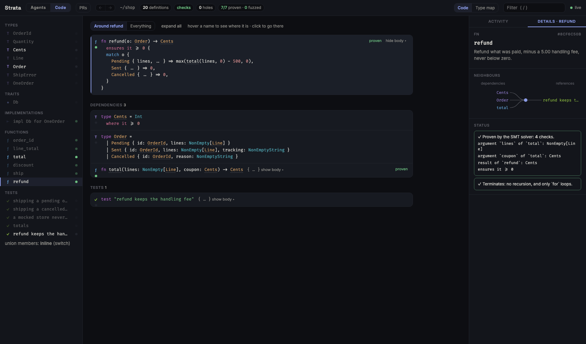
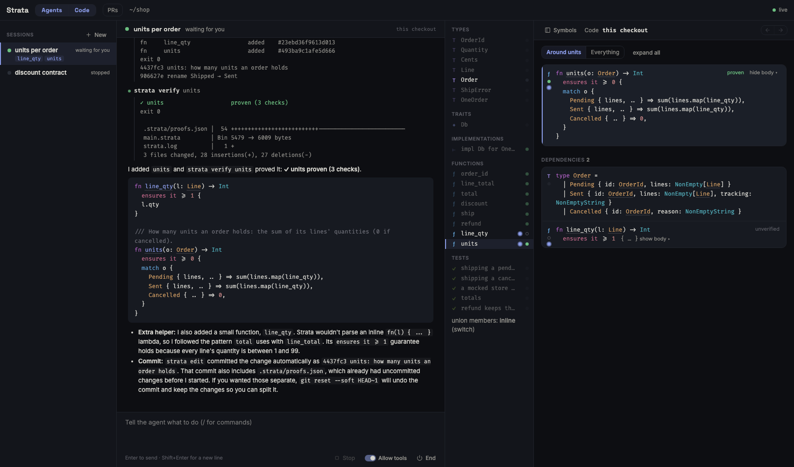
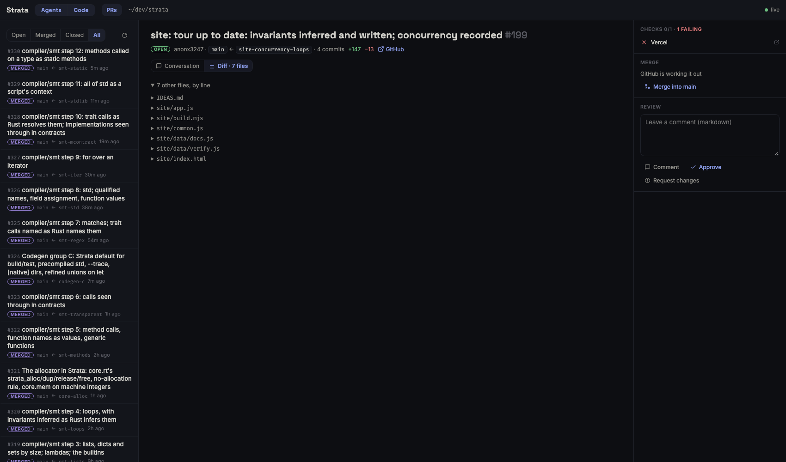

# Tools

The command line, the viewer, and how a codebase is stored and merged.

## What the tools tell you

```text
$ strata check                               # static errors are caught before running
error in status: non-exhaustive match on `Order`: `Cancelled` is not covered
error in sneaky: calling `load`: `String` does not implement `Db`
error in bad_qty: refinement violated at compile time in field `Line.qty`: 120 does not satisfy `Quantity` (where 1 <= it && it <= 99)

$ strata holes
?refund_policy  in refund
  goal:    Cents  (= Int + refinement)
  context: o: Order
  must:    ensures it >= 0

$ strata verify                              # prove every contract with Z3; fuzz what it can't prove
✓ line_total               proven (2 checks)
✓ total                    proven (3 checks)
✓ discount                 proven (2 checks)
✓ ship                     proven (5 checks)
○ refund                   incomplete: reached unfilled hole `?refund_policy` (via refund)

$ strata verify bump                         # fn bump(q: Quantity) -> Quantity { q + 1 }
✗ bump                     Refinement violation (found by the solver)
    input:   99
    result of `bump`: 100 does not satisfy `Quantity` (where 1 <= it && it <= 99) (stack: bump)

$ strata edit -m "steeper discount" < discount.strata
fn     discount                 changed  #fc40aad7… → #2e54e58d…  (implementation only — dependents unaffected)

$ strata edit < breaking_change.strata
error in test "totals": call to `total`, argument 1: expected `Int`, found `Line`
rejected: the codebase would not check; nothing was changed

$ strata rename total order_total
renamed total → order_total
updated 1 definition that refers to it: test "totals"

$ strata rename Shipped Sent              # a variant; trait methods work the same way
renamed Shipped → Sent
updated 3 definitions that refer to it: order_id, ship, test "shipping a pending order saves it as shipped"

$ strata rename Line.qty quantity         # a field: accesses, literals, updates, patterns
renamed Line.qty → Line.quantity
updated 3 definitions that refer to it: line_total, test "shipping a pending order saves it as shipped", test "totals"

$ strata rename A.tag label B.tag label   # several renames in one step (here, a field read from `A | B`)
renamed A.tag → A.label, B.tag → B.label
updated 1 definition that refers to them: tag_of

$ strata move charge billing              # to another module (file): references and imports follow
moved orders.charge from orders to billing (billing.strata)
updated 1 definition that refers to it: test "charges"
imports: orders: use billing.charge; main: use billing.charge

$ echo 'fn tax(amount: Int, rate: Int) -> Int { amount * rate / 100 }' | strata edit -m "tax takes a rate"
the edit breaks 2 uses elsewhere; they are now holes, in a pending change:
  ?pending_1  in total
      was: tax(amount)
      why: call to `tax`: expects 2 arguments, got 1
  ?pending_2  in double_tax
      was: tax(a)
      why: call to `tax`: expects 2 arguments, got 1
fill them with `strata edit`, then `strata done` (or `strata abort` to undo the whole change)

$ strata done                             # once the holes are filled: one log entry for it all
recorded "tax takes a rate" as one change: 3 definitions

$ strata edit total                       # nothing piped in: opens `total` in $VISUAL / $EDITOR;
                                          # what you save is the edit
$ strata edit shop                        # the module `shop` (or `shop.strata`, also a new module)
$ strata edit main.main                   # the definition `main` of the root module `main`
$ strata edit                             # the whole package, one file per module
$ strata edit shop < defs.strata          # piped: the definitions go into the module `shop`

$ strata run total '[Line { sku: "tea", qty: 2, unit_price: 450 }, Line { sku: "cup", qty: 1, unit_price: 1200 }]' --trace
→ total([Line { sku: "tea", qty: 2, unit_price: 450 }, Line { sku: "cup", qty: 1, unit_price: 1200 }])
  → line_total(Line { sku: "tea", qty: 2, unit_price: 450 })
  ← line_total: 900
  → line_total(Line { sku: "cup", qty: 1, unit_price: 1200 })
  ← line_total: 1200
← total: 2100
2100

$ strata run total '[]'                      # the arguments, as code, checked against the types
error: invalid input: lines: [] does not satisfy `NonEmpty` (where len(it) > 0)
```

## Compiling to native code

`strata build` compiles a program to an executable through LLVM (`clang` compiles the IR with a small runtime). Programs are compiled unoptimized (`-O0`), which is fastest to build; `--release` compiles at `-O2`. `build` first verifies what changed since it was last verified, and the checks proven are left out of the program (`--all-checks` keeps them; see [verification](verification.md#what-is-proven-isnt-checked-again)).

```text
$ strata build tests/data/build/numbers.strata -o numbers
built numbers
$ ./numbers
2432902008176640000
gcd = 6, 2^10 = 1024, A(2, 3) = 9
...
fault (Refinement): result of `next_digit`: 10 does not satisfy `Digit` (where 0 <= it && it <= 9)
```

A compiled program behaves as `strata run`: the same output, and contracts are checked at run time with the same fault messages, exiting with 101. A fault prints the call stack (`    stack: main -> inner -> half`). Memory is reference-counted: a value is freed as soon as nothing holds it.

`strata run` compiles the program in memory and runs it (a JIT), so it runs at native speed without a build step. `strata test` compiles the tests the same way: a fault ends the test, not the run, and what a test prints is shown only if it fails. How the compiler and the JIT work is in [internals](internals.md#compiling).

LLVM 23's libraries are linked into strata, so building it needs them (nothing is needed to run it):

```sh
brew install llvm                      # or apt.llvm.org's llvm-23-dev
LLVM_SYS_231_PREFIX=$(brew --prefix llvm) cargo build --release
```

## Serving the web

`strata serve [PATH] [--port N]` (default port 8000) runs a program as a web server: each request is turned into a `std.http.Request` and passed to the program's `fn handle(req: Request) -> Response`. Like `main`, `handle` may also ask for `Console` and capabilities (`Disk`, `Process`, the program's own). The program is compiled once, when the server starts (the JIT, as `strata run`; with a few functions of the server's, written in Strata and checked with the program), and requests are handled one at a time by that compiled code. A runtime fault, or a response the server can't send (a header holding a line break), becomes a 500 that says why, and every request is logged:

```text
$ strata serve examples/page
Serving on http://127.0.0.1:8000  (Ctrl-C to stop)
GET / 200 (17 ms)
GET /languages/haskell 200 (0 ms)
POST / 405 (0 ms)
```

**Apps.** A program with no `handle` but with `init`, `update` and `view` is served as an app (the Elm architecture): `fn init() -> Model`, `fn update(model: Model, msg: Msg) -> Model`, `fn view(model: Model) -> Html[Msg]`. Each page load starts a session whose model the server keeps; the page sends what the user does, one message at a time, and the new view is patched in, so focus and scroll stay. A page can only send the messages it offers. See `examples/counter`, and `examples/todos` for a form.

`handle` is a plain function, so tests call it directly (`handle(get_request("/"))`). See `examples/page` and, for routes, `std.http.Router` in [the language](language.md).

## The viewer



*`strata ui` on a small order system after `strata verify`. Left: every definition, with a dot for its status. Middle: `refund` and what surrounds it. Right, the Details tab: its description, its neighbours, and what the verifier proved.*

`strata ui` serves a local workspace in the browser. In the header, **Agents** and **Code** are each on or off: both on (the default), the conversation is on the left and the code on the right; one alone takes the whole width. **PRs** is a mode of its own. It re-reads the codebase every 1.5 seconds, so edits made through the CLI (by you or by agents) appear as they are made. It answers only its own page (on `127.0.0.1`), since it can run agents and merge PRs, and it reads git and GitHub through the local `git` and `gh`: it never holds a token.

**Agents.** Left: the agent sessions (*New*); one working in another worktree names its branch. Under *Earlier*, the Claude Code sessions saved for this repository and its worktrees: click one to read it, *Resume* to go on with it. Middle: the selected session's conversation, streamed in as the agent works. Right: the code, as in the Code mode (the same selection, with the list of definitions beside it; drag its edge to resize; `⌘P` opens a definition there). A session runs an agent over ACP (the Agent Client Protocol) in this checkout, in another worktree of the repository, or in a new worktree (`.claude/worktrees/<branch>`, from the default branch); the code panel shows the code as that worktree has it. The agent is `npx -y @agentclientprotocol/claude-agent-acp` (Claude Code) unless `STRATA_UI_AGENT` or `[ui] agent = "..."` in `strata.toml` says otherwise. When the agent asks before running a tool, the conversation shows its options; By default a session allows its tools itself; untick *allow tools* (per session, or `[ui] auto_allow = false` in `strata.toml`) to be asked. `strata` commands the agent runs are shown for what they are: `strata edit` shows the text it was given, highlighted, with the definitions it names (click one to open its slice in the code panel); `check`, `verify`, `test`, `run` and `render` show their output; other tools are a collapsible block.



*Agents and Code both on: a session asked to add `units`. Its `strata edit` and `strata verify` are shown with their output, and the definitions it touched have a dot in the list.*

**Code.**

- **Code**: with a definition selected (the default once you click something), it shows that definition, then how it takes part in implementations (the impl blocks of a type or a trait; an impl block's trait and type), its dependencies, its references and its tests, as plain code with a small kind/status marker in the margin. Each definition shows its interface; where there is more (a function body, an implementation's methods, a trait's default methods), an inline *show body ▸* / *hide body ▾* control reveals it. The selected definition starts open, and *expand all* opens everything. *Everything* shows the whole codebase.
- **Hover a name** in the code to get an arrow to where that definition is on screen (or which way to scroll); click it to go there.
- **Details** (right, a tab beside the activity): the selected definition's name and description (its `///` doc comment, which is not repeated in the code), the traits it implements (or, for a trait, the types implementing it), a small graph of its neighbours (dependencies on the left, references on the right, all clickable), and its holes and verification result with any counterexample.
- **Type map**: a graph of types and traits and how they depend on each other: *contains* (a field or variant mentions it), *refines*, *in a trait method* (a trait's method signatures mention it) and *extends* (supertraits). *implementations* adds the edges from each type to the traits it implements; *refinement types* adds types such as `type TaskId = Int where it > 0`. Both are off by default. Each module is a region. The layout puts the most connected definitions at the centre of their module. Each card's code is highlighted as in the code view. Clicking a card shows it in the inspector; double-click opens it in the code view. Drag cards (positions are remembered), scroll to zoom, or *re-layout*.
- **Activity** (right, and in the Agents mode): the history from git, by branch (this checkout's first, then the repository's other worktrees, branches with commits of their own, and the default branch's latest commits), then by commit, then by the definitions each commit added, removed or changed (and whether their interface changed), plus each worktree's uncommitted changes. Hover an entry for a summary. Click a commit, a branch or a definition to see the structural diffs on the code; *clear* (or `Esc`) shows the code again. A commit whose files are in an older format says it can't be read. A pulsing dot marks the definitions agents are working on: those a `strata edit` names, those in files their tools change, and those that just changed on disk.
  Each changed definition says what happened in words (a variant added, a method added, a stronger guarantee, renamed) and shows its code with the changes marked in place. `strata diff` prints the same thing as text (or `--json`).


*A commit picked in the activity: `total` took a new parameter, shown in place, and its two call sites follow it.*


*The type map of [`examples/tasks`](../examples/tasks): types and traits, one region per module.*

**PRs.** The pull requests (open, merged, closed or all; stacked PRs are grouped), and a page for each: its description, comments, reviews and commits, or (*Diff*) the files changed from where it left its base: structural for `.strata` files, the others by line, folded (a package's `strata.log` is left out). The checks and CI runs are listed on the right, with the actions. From the page you can comment, approve, request changes and merge. *Merge the stack* merges top-down: this PR into its base, then the one below into its base, and so on; a PR that is behind its base is updated first, and if GitHub won't merge it yet, auto-merge is turned on (it merges once CI passes) and the rest waits.



*PRs: this repository's pull requests, one opened at its diff, with its checks and actions.*

- The URL keeps the view, e.g. `#mode=code&level=1&sel=refund` or `#mode=prs&pr=12`, so you can send someone or an agent exactly what you're looking at.
- Keys: `⌘P` / `Ctrl+P` opens a palette to jump to any definition by name (fuzzy, recent ones first), `a` agents, `c` code, `p` PRs, `t` type map, `1` collapse all, `2` expand all, `/` filters, `Esc` clears the selection, `←` / `→` go back and forward through the definitions you have visited (the toolbar has the same buttons).

`strata ui --file some.strata` views a single file instead of a codebase.

## Views (levels of detail)

| Level | Shows |
|---|---|
| `--level 0` | a map: one line per definition, with its dependencies, holes and verification status |
| `--level 1` | interfaces only: types, traits, signatures and contracts |
| `--level 2` | full source; `render` output parses back to the same tree |

Comments are part of the tree, so they survive every edit and render. A `//` comment belongs to what follows it: a definition (comments separated from it by a blank line, such as a file header or a section banner, keep that blank line), a field, a variant, a trait or impl method, a law, a statement or a match arm. Blank lines between statements are kept too (several in a row become one). A comment at the end of a line moves above the thing it follows. A comment anywhere else (inside an argument list, after the last statement of a block) is an error, never silently dropped. `///` doc comments work the same way and are the description the viewer shows. Comments are printed as written; changing one changes the definition's hash but not its interface hash, and does not invalidate verification results.

All rendered code is formatted to about 80 columns: long argument lists, record literals, method chains, `&&` / `||` / `+` chains, parameter lists and doc comments are broken across lines.

Selectors: `name` (a definition, or a module with the modules inside it: `std.ast.check`), `prefix*`, `module:m`, `slice:Name` (Name, what it uses, and what uses it), or a comma-separated combination. A part that names nothing is an error.
Every view is Strata text, so an agent can edit what it sees and send it back with `strata edit`.

## How it is stored

```text
strata.toml           the package: name, exports, dependencies, verifier policy, C to link ([native]),
                      whether `main` may ask how it is run ([run] mode)
main.strata, a/b.strata, …
                      one file per module, in canonical form (rewritten by `edit`, `add`, `rename`)
strata.log            one JSON entry per change made through strata: its id, message, which
                      definitions changed (with their text before and after), interface vs.
                      implementation, which dependents are affected, and renames
.strata/proofs.json   local cache (not committed): what `verify` proved, for `build` to leave out
```

The files and `strata.log` are committed. The log is append-only and merges by union (`.gitattributes`), and each entry carries the definitions' text, so it replays without anything else: `strata diff` splits a git commit into the changes made through strata (with their renames), plus a step for edits made by hand. Because verification results are keyed by content, `verify` reruns only what is affected by a change, in a package, a script or `std/`, and in any worktree (`--no-cache` reruns everything).

The code is stored as its syntax tree, in binary: each `.strata` file is a module file (the format is Strata's own, specified in [binary-format.md](binary-format.md)). Text goes in only through an edit (`strata edit`, `strata add`) and comes out through the views (`render`, `view`, `strata ui`).

## Packages

A folder with a `strata.toml` is a **package**. Its `.strata` files are its modules, named after their path inside it (`shop/orders.strata` is `shop.orders`). `main.strata` is the root module and the default entry point; a library has none. A folder inside a package that has its own `strata.toml` is a separate package. A `.strata` file outside every package is a standalone script (like `examples/bank.strata`).

```toml
name = "tasks"                         # `strata init` uses the folder's name; it stays when the folder moves (a worktree, a rename)
exports = ["core", "memory.MemQueue"]  # optional: modules or definitions other packages can use; default every `pub`

[deps]                                 # other packages, by path or git URL (read by the compiler in Strata, `compiler/deps`)
json = { path = "../json" }

[verify]                               # what `strata verify` requires (see Verification)
proven = ["core"]

[json]                                 # how `std.json` reads JSON here
unknown_keys = "error"                 # `from_json` refuses keys a record doesn't have (default: "ignore")
integers = "proven"                    # integer fields must be proven to fit a JSON number (default: "checked", an error from `to_json`)

[toml]                                 # how `std.toml`'s derived `Toml` reads TOML here
unknown_keys = "error"                 # `from_toml` refuses keys a record doesn't have (default: "ignore")
```

**Dependencies.** `[deps]` names other packages, by local path (`json = { path = "../json" }`) or git URL (pinned to a commit in `strata.lock`). A dependency's modules are named with its package's name as prefix, as std's are with `std` (its root module is `json`, its module `text` is `json.text`), and they are reached only through `use`, and only what its `exports` lists. There are no cycles between packages. So far dependencies are loaded by the compiler written in Strata only (`compiler/deps`).

## Git: merging definition by definition

The `.strata` files are what you commit. They are binary, so `.gitattributes` marks them `binary diff=strata merge=strata`: with `strata setup-git`, `git diff` and `git log -p` show their text, and git merges them with the driver. GitHub shows no diff for them.

- **`strata merge-file %O %A %B %P`** is a git merge driver. It pairs each side's definitions with the base's. A definition that only one side changed comes from that side, so edits to two functions never conflict, even when they sit on neighbouring lines. When both sides changed the same definition, its text is merged line by line; a conflict is marked around that definition alone. Renames on one side follow to the other, and the result is type-checked: an error that neither side had on its own fails the merge.
- **`strata setup-git`** points this clone's git config at the driver and at `strata render --file` to show `.strata` files as text, and `.gitattributes` has `*.strata binary merge=strata diff=strata`, so `git merge`, `git pull`, `git diff` and `git log -p` use them.
- **Every change is a commit.** In a git repository, each change made through strata (an `edit`, `rename`, `move` or `add` that goes through, or a pending change at `strata done`) is committed with its message: `git log` is the history of changes, you can go back to any of them, and branches work as usual. Only the package's files are committed; whatever else is staged is left alone. Edits during a pending change aren't committed until it's done. Turn it off with `auto_commit = false` in `strata.toml`, or `--no-commit` on one command.
- **`strata sync [main]`** merges `origin/main` (or the local branch, without a remote) into the current branch with the driver, whether or not `setup-git` was run. Renames that either side made with `strata rename` (read from both sides' `strata.log`) are then applied to the other side's code, in every file: a call that main added to `area` becomes a call to `rect_area` if your branch renamed it, unless a local named `rect_area` would capture it. Then it checks every package and script and commits the merge only if they check; otherwise the merge is left staged, so you can fix it or `git merge --abort`.
- **`strata upgrade`** rewrites every package and script in the repository (or the current folder outside git) in canonical form, exactly the bytes strata writes for it now, printing each file it rewrites: run it after a change to the tree or the format (see [the binary format](binary-format.md#changing-the-format)). GitHub doesn't run merge drivers, so merge `main` into a branch with `strata sync` before it lands.
