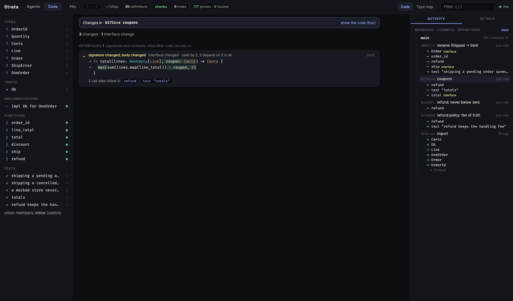
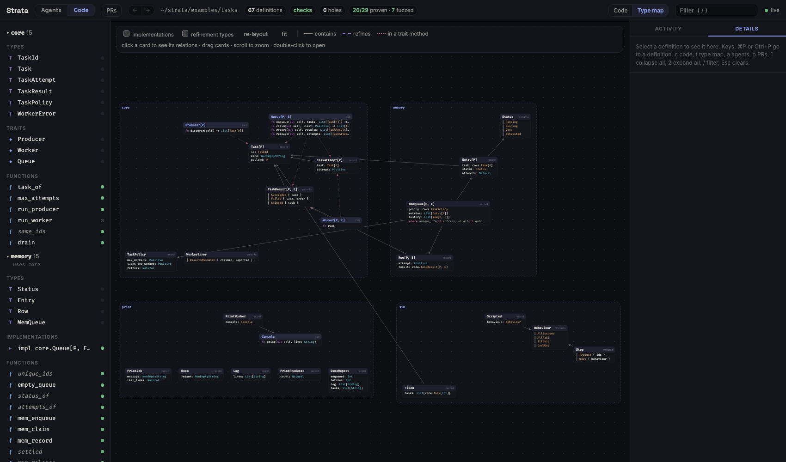

# Tools

The command line, the viewer, and how a codebase is stored and merged.

## What the tools tell you

```text
$ strata check                               # static errors are caught before running
error in status: non-exhaustive match on `Order`: `Cancelled` is not covered
error in sneaky: calling `load`: `String` does not implement `Db`
error in bad_qty: refinement violated at compile time in field `Line.qty`: 120 does not satisfy `Quantity` (where 1 <= it && it <= 99)

$ strata holes
?refund_policy  in refund
  goal:    Cents  (= Int + refinement)
  context: o: Order
  must:    ensures it >= 0

$ strata verify                              # prove every contract with Z3; fuzz what it can't prove
✓ line_total               proven (2 checks)
✓ total                    proven (3 checks)
✓ discount                 proven (2 checks)
✓ ship                     proven (5 checks)
○ refund                   incomplete: reached unfilled hole `?refund_policy` (via refund)

$ strata verify bump                         # fn bump(q: Quantity) -> Quantity { q + 1 }
✗ bump                     Refinement violation (found by the solver)
    input:   99
    result of `bump`: 100 does not satisfy `Quantity` (where 1 <= it && it <= 99) (stack: bump)

$ strata edit -m "steeper discount" < discount.strata
fn     discount                 changed  #fc40aad7… → #2e54e58d…  (implementation only — dependents unaffected)

$ strata edit < breaking_change.strata
error in test "totals": call to `total`, argument 1: expected `Int`, found `Line`
rejected: the codebase would not check; nothing was changed

$ strata rename total order_total
renamed total → order_total
updated 1 definition that refers to it: test "totals"

$ strata rename Shipped Sent              # a variant; trait methods work the same way
renamed Shipped → Sent
updated 3 definitions that refer to it: order_id, ship, test "shipping a pending order saves it as shipped"

$ strata rename Line.qty quantity         # a field: accesses, literals, updates, patterns
renamed Line.qty → Line.quantity
updated 3 definitions that refer to it: line_total, test "shipping a pending order saves it as shipped", test "totals"

$ strata rename A.tag label B.tag label   # several renames in one step (here, a field read from `A | B`)
renamed A.tag → A.label, B.tag → B.label
updated 1 definition that refers to them: tag_of

$ strata move charge billing              # to another module (file): references and imports follow
moved orders.charge from orders to billing (billing.strata)
updated 1 definition that refers to it: test "charges"
imports: orders: use billing.charge; main: use billing.charge

$ echo 'fn tax(amount: Int, rate: Int) -> Int { amount * rate / 100 }' | strata edit -m "tax takes a rate"
the edit breaks 2 uses elsewhere; they are now holes, in a pending change:
  ?pending_1  in total
      was: tax(amount)
      why: call to `tax`: expects 2 arguments, got 1
  ?pending_2  in double_tax
      was: tax(a)
      why: call to `tax`: expects 2 arguments, got 1
fill them with `strata edit`, then `strata done` (or `strata abort` to undo the whole change)

$ strata done                             # once the holes are filled: one log entry for it all
recorded "tax takes a rate" as one change: 3 definitions

$ strata edit total                       # nothing piped in: opens `total` in $VISUAL / $EDITOR;
                                          # what you save is the edit
$ strata edit shop                        # the module `shop` (or `shop.strata`, also a new module)
$ strata edit main.main                   # the definition `main` of the root module `main`
$ strata edit                             # the whole package, one file per module
$ strata edit shop < defs.strata          # piped: the definitions go into the module `shop`

$ strata run total '[Line { sku: "tea", qty: 2, unit_price: 450 }, Line { sku: "cup", qty: 1, unit_price: 1200 }]' --trace
→ total([Line { sku: "tea", qty: 2, unit_price: 450 }, Line { sku: "cup", qty: 1, unit_price: 1200 }])
  → line_total(Line { sku: "tea", qty: 2, unit_price: 450 })
  ← line_total: 900
  → line_total(Line { sku: "cup", qty: 1, unit_price: 1200 })
  ← line_total: 1200
← total: 2100
2100

$ strata run total '[]'                      # the arguments, as code, checked against the types
error: invalid input: lines: [] does not satisfy `NonEmpty` (where len(it) > 0)
```

Outside a package, `strata --file F edit < text` writes a script (or a folder's module) as given, then checks it: what doesn't check is still written, its errors are printed with `written, but F doesn't check`, and the exit code is 1. (A package's `strata edit` refuses such an edit instead.) One module file of a folder isn't checked alone, since its neighbours may not be written yet.

`--strata` and `--compare` run the front end and code generator written in Strata (the repository's `compiler/` program) in place of, or next to, the Rust ones, on the commands it implements: `check` (`compiler check`; a script or a package, its modules checked together), `lex` and `parse` (`compiler lex`, `parse`, and `stored` for `parse --stored`), `render` (`compiler written`: the stored tree written back with names as short as the module's imports allow, then printed; a whole script or each module of a package), `run` (`compiler eval`: `main` gets the arguments after `--`, else `one` and `two words` as the tests give them, its options read by the derived `CommandLine` (std.cli) as a compiled program reads them, `--help` and bad arguments ending it the same way, and a `Disk` that reads files; writing files isn't run, since `--compare` would do it twice) and `build` (`compiler codegen`, linked with `src/llvm/runtime.c` by clang; a script or a package without dependencies, with the std modules it uses; for a script, the checks `verify` proved are left out as `build` leaves them out). `--strata` prints the Strata implementation's output alone (`build --strata` writes the executable); `--compare` runs both and prints the lines only one of them gives (`only in rust: …`, `only in strata: …`; for `check` the errors, for `build` the two programs' stdout, stderr and exit code), exit 0 when they agree, 1 when not. On a package, `lex` and `parse` take each module's text (as `render` writes it), `render` each module file (std's named `std.io`, …), `run` the program packed into one bundle (`strata pack`); their lines are prefixed with the module's name. Where the Strata side doesn't cover a case (a program `compiler/codegen` can't compile yet), it says so and exits 2. The compiler package is the `compiler/` folder of the repository `strata` runs in (in the current folder or above, or above the `strata` executable; `STRATA_COMPILER=DIR` names another), built once with `strata build` into `~/.cache/strata/compiler/<hash>` (`STRATA_CACHE`) and rebuilt when it, `std/` or `strata` changes; without it, the flags say so and exit 2. `verify` has no Strata implementation yet. `lex` and `parse` are the Strata side's by default (`--rust` runs the Rust lexer and parser, the reference the tests compare against; without a compiler package they fall back to Rust), and so are `render` of a whole script without a view's options, `run` of a program's `main` (`run [PATH] [-- ARGS]`, no `--trace`), and the code `build` and `test` generate (see [Compiling to native code](#compiling-to-native-code)); `--rust` runs Rust's, and what the Strata side doesn't cover (a package's module, `--split`, `--level`, `--members`, one function called, a program the evaluator stops on, such as `select`, `race` or writing files) is Rust's.

## Compiling to native code

`strata build` compiles a program to an executable through LLVM: it writes LLVM IR as text, and `clang` compiles it with a small C runtime (`STRATA_CC` chooses another compiler). `--emit-llvm` prints the IR instead. Two code generators write that IR. By default it is `compiler/codegen`, the one written in Strata (for `strata test`, with `--file`); where it doesn't cover a program yet, `build` says so (`note: …; using llvm.rs`) and the Rust one, `src/llvm.rs`, compiles it. `--rust` (or `STRATA_BACKEND=rust`) asks for the Rust one, which also builds `--emit-llvm`, `test --with-deps` and the compiler package itself (building it with `compiler/codegen` would need it built first). The first build after a change to `compiler/` or `std/` rebuilds the compiler package (about 2 minutes, then cached).

Programs are compiled unoptimized (`-O0`), which is fastest to build; `--release` compiles at `-O2` and merges the runtime into the executable (`-flto`). `run` and `test` take `--release` too. Compile-time code and the probes that confirm counterexamples are always unoptimized (they run once), `verify`'s fuzzing always optimized (its cases run many times), and std's precompiled library is built once at `-O2`.

The runtime is C (`src/llvm/runtime.c`) but for `core.rt`, written in Strata: the memory allocator (`strata_alloc`, `strata_dup`, `strata_release`, `strata_free`) and `strata_unique`. `strata build-core` compiles it to LLVM IR with the C runtime's names, every executable links it, and strata itself is built in two stages to use it (`tools/bootstrap.sh`, see [internals](internals.md)). `build` first verifies what changed since it was last verified (`--no-verify` doesn't), and the checks proven are left out of the program (`--all-checks` keeps them; see [verification](verification.md#what-is-proven-isnt-checked-again)).

```text
$ strata build tests/data/build/numbers.strata -o numbers
built numbers
$ ./numbers
2432902008176640000
gcd = 6, 2^10 = 1024, A(2, 3) = 9
...
fault (Refinement): result of `next_digit`: 10 does not satisfy `Digit` (where 0 <= it && it <= 9)
```

A compiled program behaves as `strata run`: the same output, and contracts are checked at run time with the same fault messages (refinements of parameters, results, annotated bindings, declared variables and new values, `requires`, `ensures`, `assert`), exiting with 101. The language compiles (there is no interpreter), but for a few methods called on a value of a trait type (one taking `Self` inside another type, such as `List[Self]`, or type parameters together with `Self` or `mut`), which are refused saying so. In particular:

- `Int`, which never overflows: one in [-2^62, 2^62) is a machine integer, and arithmetic on it stays inline; any other is a big integer in the runtime (kept in the 64-bit values outside that range, so comparing a small and a big integer needs no call). `Float`, `Bool`, `String`, `()`, and refinements of them;
- records, variants (`Option`, `Result` and your own), tuples, `distinct` types, unions of any types; field access, `{ ..e, f: x }`, assigning a field (`x.a.b = e`), `is`, `==` on any of them, and printing them as code (`Debug` / `Display`);
- generic functions and types (each compiled once per set of type arguments), a type's own methods (`impl Item { ... }`), and traits: implementations chosen from the type where the call is compiled (default methods, supertraits, generic traits and implementations, static methods like `T.empty()`, a variant's own implementation chosen by its tag), with the trait's `requires` and `ensures` on every implementation;
- lists: literals, `+`, list patterns (`[x, ..rest]`), `for` over a list, `xs[i]` and slices (`xs[1..]`), and the list built-ins (`len`, `get`, `at`, `slice`, `push`, `take`, `drop`, `range`, `map`, `filter`, `fold`, `all`, `any`, `find`, `count`, `contains`, `reverse`, `sort`, `sort_by`, `zip`, `enumerate`, `sum`, `join`), most of them written in Strata (`src/llvm/prelude.strata`);
- dictionaries and sets: literals (`Dict { "a": 1 }`, `Set { 1, 2 }`, typed empty ones), `dict`, `set`, `insert`, `remove`, `get`, `contains`, `keys`, `values`, `items`, `map_values`, `to_list`, `union`, `intersection`, `difference`, `len`, `for` over them (a dictionary gives `(key, value)` pairs), `==`, printing (`Debug` / `Display`), and the refinements of their elements, keys and values. Each is a list kept in the order on values (a set's elements, a dictionary's pairs by key), so equal collections are equal lists; their built-ins are Strata over lists, given the order of the element type;
- strings: `+`, comparisons, a string's units (`bytes()`, `code_points()`, `graphemes()`) and positions as byte offsets (`byte_len`, `byte_slice`, `index_of`), and the string built-ins (`split`, `lines`, `trim`, `contains`, `starts_with`, `ends_with`, `replace`, `repeat`, `reverse`, `chars`, `to_upper`, `to_lower`, `is_digit`, `is_alpha`, `is_space`, `ord`, `chr`, `parse_int`, `parse_float`); most of them are Strata in the prelude over `byte_len` / `byte_at` / `byte_slice`, the rest (`trim`, case mappings, the `is_` tests, parsing numbers) C in the runtime, case mappings and `is_alpha` from tables made from Rust's;
- iterators (`for` over any `Iterator`, lazy `map` / `filter`, `iter()`), tasks (`scope`, `spawn`, `await`, a thread per task), channels and `select`, written `invariant`s (checked at the loop's head), and `extern c` calls;
- lambdas and closures, named functions as values (`filter(is_prime)`), functions returning functions;
- functions and recursion, bindings (`x := e`, with patterns, `let x: T = e`), `mut` variables and assignment (`=`, `+=`, …), `if`, `match` with every pattern, `while`, `loop`, `for`, `break`, `continue`, `return`, `assert`, `!`, `?`, `except`;
- f-strings with format specs (`{x:.2}`, `{n:>5}`, `{n:05}`, `{s:*^9}`), and `print`, `to_string`, `abs`, `min`, `max`, `float`, `floor`, `ceil`, `round`, `sqrt`;
- `mut` parameters and receivers (`restock(mut line.qty, 5)`, `mut console.print(s)`): the function changes the caller's variable in place, and the variable's declared type is checked after the call;
- capabilities: `main` can ask for `Console` (std.io) and capabilities such as `Disk`, `Process` and `Codebase` (std.fs, std.process, std.code), and gets the terminal, the disk, the process and the codebase in the current folder, as with `strata run` (the program's arguments too). `Codebase`'s snapshot is built by strata and written into the program's memory, so a program built with `strata build` has none (it faults saying so). A parameter whose type is a trait (`console: Console`) is compiled once per implementation passed to it, as the language defines it (`console: C` for some `C: Console`): the real console and a `Recorder` in a test each get their own. A trait used as the type of a field, a list element or a `let` (`{ console: Console }`, `List[Shape]`) holds any implementation: the value carries its implementation's table of methods, and calls go through it;
- options: `main` can ask for a record that derives `CommandLine` (std.cli); the compiled program reads it with the same `from_args`, so `--help` and the messages for bad arguments are `strata run`'s (exit code 0 after the help, 2 after an error). The usage line names the executable as it was started (`strata build` names it after the package, as `strata run` does);
- `main` returns `()`, an exit code, or a `Result` of either.

A fault prints the call stack as `strata run` does (`    stack: main -> inner -> half`), and running out of stack is a fault (`fault (Limit): stack overflow (recursion too deep)`), not a crash. There is no other limit: loops run as long as they run, and a recursion as deep as the stack allows; the `stack:` line shows a recursion as one entry (`main -> down (95846 times)`).

`matches(s, re)` is `std.regex`'s, compiled. A literal pattern's matcher (`std.regex.matcher`: a DFA, or the Pike VM's program when the pattern asserts more than `^` and `$`) is made while compiling, as compile-time code is (cached), and is data in the program. A pattern built at run time is matched by `std.regex` (its parser and Pike VM, written in Strata and precompiled with std), in a built program too; a bad one faults with `std.regex`'s message (`bad regex: unclosed group (at character 11)`). Memory is reference-counted: a value is freed as soon as nothing holds it. With `STRATA_MEMORY` set, a compiled program reports how many objects it allocated and freed when it exits (`memory: 128 allocated, 128 freed, 0 live`); with `STRATA_MEMORY=check` it also keeps freed memory aside, stops on any use of a freed object (`memory: drop of a freed object`), and lists the objects still alive at the end (the tests of `strata build` run every program this way).

### The JIT

`strata verify` runs only compiled code (`--jit` says why a function's fuzzer couldn't be compiled, which is then skipped). Fuzzing: a driver per function generates its arguments (the generators `mock` uses), records them for a counterexample, and calls it, all in one module compiled once; a trait method of an implementation, and a law, are fuzzed through a wrapper function (a law's ensures it holds). Loops and calls count steps, so a runaway case is a `Limit` fault (`too many steps`). The solver's counterexamples are confirmed by running them compiled (a probe binding the values to the parameters' types, then calling the function), and so are literal arguments that break a refinement (`attr("onclick", …)`), an error before anything runs. Probes, like compile-time code, are compiled without optimization: they run once.

`strata test` compiles the tests the same way: each `test` block is a function, a fault ends the test instead of the process, and what a test prints is kept for the report (`strata test --emit-llvm` prints the tests' IR). A test that can't be compiled yet fails, saying why; the others run. Only the project's own tests run, those in its files (the package's, or the script's): what it imports (std, and dependencies once they are fetched) is compiled, verified and tested on its own (std with `strata --file std test`), so its tests aren't run again. `strata test --with-deps` runs them too.

`strata run` compiles the same IR in memory with LLVM's libraries and runs it (the JIT), so a program runs at native speed without a build step (`fib(32)`: 26 ms, compilation included). What can't be compiled yet is an error that says why (there is no interpreter). `strata run f [ARGS]` calls one function, compiled: its arguments, written as code (`'"abc", 3'`), go into a function that calls it, checked with the program, and its result is read back from memory and printed as code, and `--trace` has compiled code print each call and return. Compile-time code runs on the JIT too: in a `derive`, and `comptime e` anywhere else, whose value is computed while compiling and written into the program as a constant (`re := comptime parse("[a-z]+")` never calls `parse` when the program runs). `e` may use definitions, not the variables around it. In the compiler written in Strata (`compiler codegen`, which `build` uses), `comptime e` is compiled by compiler/codegen and run by the compiler's own JIT in its process, within 5,000,000 steps, and its value is read back from memory by its type (codegen's `read_back`, core.values) and written in with that type; what codegen can't compile yet, and the small pieces of a derive's code, run on compiler/eval.

LLVM 23's libraries are linked into strata, so building it needs them (nothing is needed to run it):

```sh
brew install llvm                      # or apt.llvm.org's llvm-23-dev
LLVM_SYS_231_PREFIX=$(brew --prefix llvm) cargo build --release
```

Both ways share one code generator (the IR as text, which LLVM parses for the JIT) and one runtime (`runtime.c`, built into `strata` for the JIT, compiled with the program by `strata build`).

## Serving the web

`strata serve [PATH] [--port N]` (default port 8000) runs a program as a web server: each request is turned into a `std.http.Request` and passed to the program's `fn handle(req: Request) -> Response`. Like `main`, `handle` may also ask for `Console` and capabilities (`Disk`, `Process`, the program's own). The program is compiled once, when the server starts (the JIT, as `strata run`; with a few functions of the server's, written in Strata and checked with the program), and requests are handled one at a time by that compiled code. A runtime fault, or a response the server can't send (a header holding a line break), becomes a 500 that says why, and every request is logged:

```text
$ strata serve examples/page
Serving on http://127.0.0.1:8000  (Ctrl-C to stop)
GET / 200 (17 ms)
GET /languages/haskell 200 (0 ms)
POST / 405 (0 ms)
```

**Apps.** A program with no `handle` but with `init`, `update` and `view` is served as an app (the Elm architecture): `fn init() -> Model`, `fn update(model: Model, msg: Msg) -> Model`, `fn view(model: Model) -> Html[Msg]`. Each page load starts a session whose model the server keeps (in compiled code's memory, between requests); the page loads a small script (`/_strata/app.js`, built into `strata`) that sends what the user does, one at a time, and puts the new view in place. Messages aren't written into the page: `render` numbers the page's handlers (`on_click(msg)`, also `dblclick`, `submit`, `change`; those that make a message from what the user entered, `on_input`, `on_change`, `on_submit_form`; timers and keys), the page sends the number (with the value or the form's fields), and the server calls `std.web.dispatch` on the current view to get the message. So a page can only send the messages it offers: a handler it doesn't have is refused (400). The page is patched rather than replaced, so focus and scroll stay, and the field being typed in keeps what was typed (after a submit, the view's value wins, so a form can clear it). A fault in `update` is a 500 shown at the bottom of the page, and the model stays as it was; a session the server no longer has (it restarted) reloads the page. See `examples/counter`, and `examples/todos` for a form.

`init` and `update` may ask for capabilities after their other parameters (`fn update(model: Model, msg: Msg, files: Files) -> Model`), as `handle` can. When the new model's view is the page the user already has, the server answers `204` and the page stays as it is. Three more things come from attributes of the view: `every(ms, msg)` sends `msg` every `ms` milliseconds while the element is on the page (not while another message is on its way), to follow something that changes outside the program; `on_key(key, msg)` (several at once: `key_bindings([("/", Search), ("meta+p", Palette)])`) sends `msg` when the key is pressed anywhere on the page, and the browser doesn't also act on it (only keys with `ctrl+`/`meta+`, and `Escape`, reach the app while the user types in a field); `focused()` and `revealed()` give an element the focus, or scroll it into view, when the attribute appears.

`handle` is a plain function, so tests call it directly (`handle(get_request("/"))`). See `examples/page` and, for routes, `std.http.Router` in [the language](language.md).

## The viewer


*`strata ui` on a small order system after `strata verify`. Left: every definition, with a dot for its status. Middle: `refund` and what surrounds it. Right, the Details tab: its description, its neighbours, and what the verifier proved.*

`strata ui` serves a local workspace in the browser. In the header, **Agents** and **Code** are each on or off: both on (the default), the conversation is on the left and the code on the right; one alone takes the whole width. **PRs** is a mode of its own. It re-reads the codebase every 1.5 seconds, so edits made through the CLI (by you or by agents) appear as they are made. It answers only its own page (on `127.0.0.1`), since it can run agents and merge PRs, and it reads git and GitHub through the local `git` and `gh`: it never holds a token.

**Agents.** Left: the agent sessions (*New*); one working in another worktree names its branch. Under *Earlier*, the Claude Code sessions saved for this repository and its worktrees: click one to read it, *Resume* to go on with it. Middle: the selected session's conversation, streamed in as the agent works. Right: the code, as in the Code mode (the same selection, with the list of definitions beside it; drag its edge to resize; `⌘P` opens a definition there). A session runs an agent over ACP (the Agent Client Protocol) in this checkout, in another worktree of the repository, or in a new worktree (`.claude/worktrees/<branch>`, from the default branch); the code panel shows the code as that worktree has it. The agent is `npx -y @agentclientprotocol/claude-agent-acp` (Claude Code) unless `STRATA_UI_AGENT` or `[ui] agent = "..."` in `strata.toml` says otherwise. When the agent asks before running a tool, the conversation shows its options; By default a session allows its tools itself; untick *allow tools* (per session, or `[ui] auto_allow = false` in `strata.toml`) to be asked. `strata` commands the agent runs are shown for what they are: `strata edit` shows the text it was given, highlighted, with the definitions it names (click one to open its slice in the code panel); `check`, `verify`, `test`, `run` and `render` show their output; other tools are a collapsible block.


*Agents and Code both on: a session asked to add `units`. Its `strata edit` and `strata verify` are shown with their output, and the definitions it touched have a dot in the list.*

**Code.**

- **Code**: with a definition selected (the default once you click something), it shows that definition, then how it takes part in implementations (the impl blocks of a type or a trait; an impl block's trait and type), its dependencies, its references and its tests, as plain code with a small kind/status marker in the margin. Each definition shows its interface; where there is more (a function body, an implementation's methods, a trait's default methods), an inline *show body ▸* / *hide body ▾* control reveals it. The selected definition starts open, and *expand all* opens everything. *Everything* shows the whole codebase.
- **Hover a name** in the code to get an arrow to where that definition is on screen (or which way to scroll); click it to go there.
- **Details** (right, a tab beside the activity): the selected definition's name and description (its `///` doc comment, which is not repeated in the code), the traits it implements (or, for a trait, the types implementing it), a small graph of its neighbours (dependencies on the left, references on the right, all clickable), and its holes and verification result with any counterexample.
- **Type map**: a graph of types and traits and how they depend on each other: *contains* (a field or variant mentions it), *refines*, *in a trait method* (a trait's method signatures mention it) and *extends* (supertraits). *implementations* adds the edges from each type to the traits it implements; *refinement types* adds types such as `type TaskId = Int where it > 0`. Both are off by default. Each module is a region. The layout puts the most connected definitions at the centre of their module. Each card's code is highlighted as in the code view. Clicking a card shows it in the inspector; double-click opens it in the code view. Drag cards (positions are remembered), scroll to zoom, or *re-layout*.
- **Activity** (right, and in the Agents mode): the history from git, by branch (this checkout's first, then the repository's other worktrees, branches with commits of their own, and the default branch's latest commits), then by commit, then by the definitions each commit added, removed or changed (and whether their interface changed), plus each worktree's uncommitted changes. Hover an entry for a summary. Click a commit, a branch or a definition to see the structural diffs on the code; *clear* (or `Esc`) shows the code again. A commit whose files are in an older format says it can't be read. A pulsing dot marks the definitions agents are working on: those a `strata edit` names, those in files their tools change, and those that just changed on disk.
  Each changed definition says what happened in words (a variant added, a method added, a stronger guarantee, renamed) and shows its code with the changes marked in place: unchanged members and lines fold away, keeping the lines that enclose each change; a new `ensures` is bold with a *stronger guarantee* pill (a removed one: *weaker*, a new `requires`: *stricter precondition*); a mostly rewritten body falls back to a line diff; a doc change is a word diff. Each change shows only what it needs: a rename is one line (`Order.Shipped → Order.Sent`); a new signature or contract shows the signature and its conditions, not the body; a changed body is shown. Definitions that only follow an interface change (a rename, or call sites given a new argument) are listed under it, each opening to its own diff, and *show the code* opens the whole definition. Changes are ordered types → interfaces → implementations → tests, then verification before → after. `strata diff` prints the same thing as text (or `--json`).



*A commit picked in the activity: `total` took a new parameter, shown in place, and its two call sites follow it.*



*The type map of [`examples/tasks`](../examples/tasks): types and traits, one region per module.*

**PRs.** The pull requests (open, merged, closed or all; stacked PRs are grouped), and a page for each: its description, comments, reviews and commits, or (*Diff*) the files changed from where it left its base: structural for `.strata` files, the others by line, folded (a package's `strata.log` is left out). The checks and CI runs are listed on the right, with the actions. From the page you can comment, approve, request changes and merge. *Merge the stack* merges top-down: this PR into its base, then the one below into its base, and so on; a PR that is behind its base is updated first, and if GitHub won't merge it yet, auto-merge is turned on (it merges once CI passes) and the rest waits.


*PRs: this repository's pull requests, one opened at its diff, with its checks and actions.*

- The URL keeps the view, e.g. `#mode=code&level=1&sel=refund` or `#mode=prs&pr=12`, so you can send someone or an agent exactly what you're looking at.
- Keys: `⌘P` / `Ctrl+P` opens a palette to jump to any definition by name (fuzzy, recent ones first), `a` agents, `c` code, `p` PRs, `t` type map, `1` collapse all, `2` expand all, `/` filters, `Esc` clears the selection, `←` / `→` go back and forward through the definitions you have visited (the toolbar has the same buttons).

`strata ui --file some.strata` views a single file instead of a codebase.

`strata ui --strata` serves the viewer written in Strata instead ([`src/ui/viewer.strata`](../src/ui/viewer.strata), built into `strata`): an app (`std.web`) that reads the codebase through `Codebase` (`std.code`), served by `strata serve`'s runtime. It has the code view: the list, the cards around the selection with names linked to their definitions, the inspector and the log, the filter, back and forward, and the keys (`/`, `Esc`, `1`, `2`, `←`, `→`). It doesn't have the Changes view, the type map or the ⌘P palette yet. It runs compiled, as every app does: the first start compiles std's library and its compile-time values once (cached), then a start takes about 10 s and a click well under a second on `examples/tasks`.

## Views (levels of detail)

| Level | Shows |
|---|---|
| `--level 0` | a map: one line per definition, with its dependencies, holes and verification status |
| `--level 1` | interfaces only: types, traits, signatures and contracts |
| `--level 2` | full source; `render` output parses back to the same tree |

Comments are part of the tree, so they survive every edit and render. A `//` comment belongs to what follows it: a definition (comments separated from it by a blank line, such as a file header or a section banner, keep that blank line), a field, a variant, a trait or impl method, a law, a statement or a match arm. Blank lines between statements are kept too (several in a row become one). A comment at the end of a line moves above the thing it follows. A comment anywhere else (inside an argument list, after the last statement of a block) is an error, never silently dropped. `///` doc comments work the same way and are the description the viewer shows. Comments are printed as written; changing one changes the definition's hash but not its interface hash, and does not invalidate verification results.

All rendered code is formatted to about 80 columns: long argument lists, record literals, method chains, `&&` / `||` / `+` chains, parameter lists and doc comments are broken across lines.

Selectors: `name` (a definition, or a module with the modules inside it: `std.ast.check`), `prefix*`, `module:m`, `slice:Name` (Name, what it uses, and what uses it), or a comma-separated combination. A part that names nothing is an error.
Every view is Strata text, so an agent can edit what it sees and send it back with `strata edit`.

## How it is stored

```text
strata.toml           the package: name, exports, dependencies, verifier policy, C to link ([native]),
                      whether `main` may ask how it is run ([run] mode)
main.strata, a/b.strata, …
                      one file per module, in canonical form (rewritten by `edit`, `add`, `rename`)
strata.log            one JSON entry per change made through strata: its id, message, which
                      definitions changed (with their text before and after), interface vs.
                      implementation, which dependents are affected, and renames
.strata/proofs.json   local cache (not committed): what `verify` proved, for `build` to leave out
```

`verify`'s verdicts are kept outside the package, shared by every worktree of its git repository (`.git/strata/verdicts`; outside a repository, `~/.cache/strata/verdicts`), one file per verdict, keyed by the hash of a definition *and everything it depends on*, with the check's name and the run's settings.

The files and `strata.log` are committed. The log is append-only and merges by union (`.gitattributes`), and each entry carries the definitions' text, so it replays without anything else: `strata diff` splits a git commit into the changes made through strata (with their renames), plus a step for edits made by hand. Because verification results are keyed by content, `verify` reruns only what is affected by a change, in a package, a script or `std/`, and in any worktree (`--no-cache` reruns everything).

The code is stored as its syntax tree, in binary: each `.strata` file is a module file (the format is Strata's own, specified in [binary-format.md](binary-format.md)). Text goes in only through an edit (`strata edit`, `strata add`) and comes out through the views (`render`, `view`, `strata ui`); `strata render --split DIR` writes a package's text, one `.st` file per module, to read rather than to read back; a type one union lists is shown inside it unless it has a doc or an `impl` of its own, and `--members separate` shows every member as a definition of its own (the same program either way). Outside a package's log, `strata --file F edit < text` stores a script (or, with `--file DIR/ edit MODULE`, a module of a folder), created if it is new; only text that doesn't parse is refused. Each module file starts with a header listing its definitions, their hashes and dependencies (`strata header core.strata` prints it), and each definition stores its interface before its bodies. `strata pack app.strata` writes the whole program as one bundle, which `--file`, `strata run` and every view read like the package. The hashes `strata` shows are those of the binary encoding (see the spec).

## Packages

A folder with a `strata.toml` is a **package**. Its `.strata` files are its modules, named after their path inside it (`shop/orders.strata` is `shop.orders`). `main.strata` is the root module and the default entry point; a library has none. A folder inside a package that has its own `strata.toml` is a separate package. A `.strata` file outside every package is a standalone script (like `examples/bank.strata`).

```toml
name = "tasks"                         # `strata init` uses the folder's name; it stays when the folder moves (a worktree, a rename)
exports = ["core", "memory.MemQueue"]  # optional: modules or definitions other packages can use; default every `pub`

[deps]                                 # other packages, by path or git URL (read by the compiler in Strata, `compiler/deps`)
json = { path = "../json" }

[verify]                               # what `strata verify` requires (see Verification)
proven = ["core"]

[json]                                 # how `std.json` reads JSON here
unknown_keys = "error"                 # `from_json` refuses keys a record doesn't have (default: "ignore")
integers = "proven"                    # integer fields must be proven to fit a JSON number (default: "checked", an error from `to_json`)

[toml]                                 # how `std.toml`'s derived `Toml` reads TOML here
unknown_keys = "error"                 # `from_toml` refuses keys a record doesn't have (default: "ignore")
```

**Dependencies.** `[deps]` names other packages, by local path (`json = { path = "../json" }`) or git URL (`json = "https://…"`, or `{ git = "URL", tag = "v1" }`, `rev`, `branch`; pinned to a commit in `strata.lock`, fetched into `$STRATA_CACHE`, else `~/.cache/strata`, and moved by `update`); the key is the dependency's `name`. A dependency's modules are named with its package's name as prefix, as std's are with `std`: its root module (`main.strata`) is `json`, its module `text` is `json.text`, and a module of the package can't be named like one of its dependencies (`` module `json` is named like the dependency `json` ``). Inside the dependency nothing changes (its root module's definitions, union and sum variants included, stay visible short to its other modules); everywhere else it is reached only through `use` (`use json`, `from json use parse`, `use json.text`), and only what its strata.toml `exports` (modules, or single definitions: `exports = ["text", "parse"]`, a root module definition by its name or `main.NAME`, the root module as `main`; default every `pub` definition): using the rest is an error, worded like a private definition's (`` `parse` isn't exported by package `json` ``). A dependency's definitions are read lazily, as the program reaches them: only the module files it reaches are read, and only the definitions it reaches are decoded (a variant or a trait's method brings its own type or trait). There are no cycles between packages: if `a` depends on `b`, `b` may not depend on `a`, directly or through others (`dependency cycle: a -> b -> a`); cycles between the modules of one package are fine. std depends on nothing. A dependency is checked, verified and tested in its own package: the commands report only the package's own definitions, and a dependency's `test` blocks are left out (`strata test --with-deps` runs them; the Strata compiler's `check --with-deps` checks them). So far this is built in the compiler written in Strata (`compiler/deps` and `compiler/main`: its `package [--std DIR] DIR`, `check [--std DIR] [--with-deps] DIR` and `update DIR [NAME...]` commands; it has no `test` or `verify` command yet); the Rust `strata` commands don't load dependencies.

Loading a package (for `check`, `run`, `verify`, …) fails on an export that names nothing, or a definition that isn't `pub`.

## Git: merging definition by definition

The `.strata` files are what you commit. They are binary, so `.gitattributes` marks them `binary diff=strata merge=strata`: with `strata setup-git`, `git diff` and `git log -p` show their text, and git merges them with the driver. GitHub shows no diff for them.

- **`strata merge-file %O %A %B %P`** is a git merge driver. It pairs each side's definitions with the base's. A definition that only one side changed comes from that side, so edits to two functions never conflict, even when they sit on neighbouring lines. When both sides changed the same definition, its canonical text is merged line by line, and the result is kept only if it parses back into that one definition; otherwise conflict markers go around that definition alone, and the file is left as text: fix it, then `strata resolve FILE` stores it as a module file again. A rename on one side (a definition gone, and a new one that is the base's after `strata rename`) is applied to the other side, so new calls to the old name follow it. Then the file is type-checked inside its package: an error that neither side had on its own (ours changed a signature, theirs added a call to the old one) fails the merge. A side that isn't a module file isn't merged: ours stays.
- **`strata setup-git`** points this clone's git config at the driver and at `strata render --file` to show `.strata` files as text, and `.gitattributes` has `*.strata binary merge=strata diff=strata`, so `git merge`, `git pull`, `git diff` and `git log -p` use them.
- **Every change is a commit.** In a git repository, each change made through strata (an `edit`, `rename`, `move` or `add` that goes through, or a pending change at `strata done`) is committed with its message: `git log` is the history of changes, you can go back to any of them, and branches work as usual. Only the package's files are committed; whatever else is staged is left alone. Edits during a pending change aren't committed until it's done. Turn it off with `auto_commit = false` in `strata.toml`, or `--no-commit` on one command.
- **`strata sync [main]`** merges `origin/main` (or the local branch, without a remote) into the current branch with the driver, whether or not `setup-git` was run. Renames that either side made with `strata rename` (read from both sides' `strata.log`) are then applied to the other side's code, in every file: a call that main added to `area` becomes a call to `rect_area` if your branch renamed it, unless a local named `rect_area` would capture it. Then it checks every package and script and commits the merge only if they check; otherwise the merge is left staged, so you can fix it or `git merge --abort`.
- **`strata upgrade`** rewrites every package and script in the repository (or the current folder outside git) in canonical form, exactly the bytes strata writes for it now, printing each file it rewrites: run it after a change to the tree or the format (see [the binary format](binary-format.md#changing-the-format)). GitHub doesn't run merge drivers, so merge `main` into a branch with `strata sync` before it lands.
